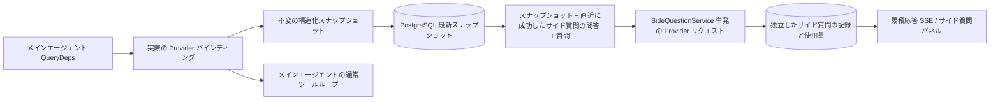

# ARTEX `/btw` サイド質問

日本語 · [한국어](README.ko.md) · [中文](README.zh.md)

一般のチャット、タスクの MainAgent、そして現在のタスクが直接起動した Worker は、本文の会話とは分かれたサイド質問を、それぞれサポートします。メインの入力欄に `/btw 質問` と入れるとサイド質問を提出し、内容のない `/btw` だけを入れるか、「サイド質問」ボタンを押すと、以前のサイド質問の記録を開きます。デスクトップでは幅を変えられるサイドバー、モバイルではドロワー（Drawer）として表示します。

サイド質問の応答は、質問を提出した時点のエージェントのコンテキストスナップショットをもとに生成します。ストリーミング表示、追加の質問、停止、クリアに対応します。パネルを閉じても、ページを再読み込みしても、SSE 接続が切れても、モデルへのリクエストは取り消されません。停止が影響するのは、いま進んでいるサイド質問 1 件だけです。クリアはサイド質問を取り消し、サイド質問の記録も削除しますが、本文のコンテキストスナップショットはそのまま残します。

> この文章は、中国語の原文を韓国語にローカライズした文書を、さらに日本語へ訳したものです。上流との差分を取りやすいように、中国語の原文（`README.zh.md`）はそのまま保存してあります。

## 実装の範囲

Go、norma v0.3.7、Next.js、そして既存の Markdown、ResizablePanel、Drawer、AlertDialog のコンポーネントをそのまま使います。norma のソースは変更せず、サイド質問のために新しい依存も追加していません。Planner、ほかのタスクから引き継いだ Worker、ツール型の子タスクの昇格は、今回の範囲に入りません。

- `capture.go` は、`Options.Deps.CallModel` と `CallModelSync` だけで、メインループのリクエストとして印を付けます。Provider のデコレータは個別のモデルの内部、つまりルーティングプールが外側でモデルを選んだ次の段階に置かれるので、実際に選ばれたモデルを記録します。圧縮のリクエストと要約のリクエストは、スナップショットを上書きしません。
- リクエストを始めた時点、モデルが応答を完結した時点、実行が終了状態に達した時点で、スナップショットを発行します。生成の途中の半分の応答は発行しません。ツール呼び出しは norma の `MessagesForAPI` を通して組を保ち、ツールの結果は、次のメインモデルのリクエストか、実行の終了状態でスナップショットに入ります。ストリーミングが中断すると、直前の有効な境界を保ちます。
- スナップショットは JSON の深いコピーで、構造化メッセージ、システムプロンプト、ツール定義、生成パラメータを保ちます。モデルの推論は、スナップショットのロックもデータベースのトランザクションも持ちません。
- `SideQuestionService` は個別の Provider を呼び出します。必要なら、まずサイド質問の要約を作ります。最終応答は、コンテキストが初めて上限を超え、まだテキストもツール呼び出しも出していない場合に限り、1 回だけ縮めて再試行します。エージェントのセッションは新しく作らず、ツール実行器、メインの transcript、アクティビティストリーム、タスクグラフには接続せず、タスクのモデル切り替えの連鎖も通りません。応答がツール定義を保つのは、既存の構造化ツールのコンテキストと両立させるためです。要約のリクエストにはツールを渡しません。新しく返されたツール呼び出しには、実行の経路がありません。
- 親セッションごとに、実行中のリクエストは 1 つです。サービスプロセス 1 つあたり最大 4 つで、リクエスト 1 つの制限時間は 120 秒です。サイド質問は、サービスのライフサイクルの下で、独立したキャンセルコンテキストを使います。
- サイド質問のリクエストは、モデル設定への参照と、機微でない識別情報の要約を保管し、リクエストする時点で既存の設定から資格情報を取ります。設定が削除されたとき、またはモデル、プロトコル、アドレスのような識別フィールドが変わったときは、まずメインエージェントを実行してスナップショットを更新するよう求めます。テストは、製品の既定モデルを変えません。

## 永続化と復旧

`db/schema.sql` は、`side_question_sessions` と `side_question_requests` のテーブルを自動で作ります。前のテーブルは、親リソース、最新のスナップショット、実行番号、バージョン、整理バージョンを保存します。後ろのテーブルは、質問、累積応答、状態、モデル、スナップショットの時刻、使用量、イベントの順番、ページの順番を保存します。

親セッションのキーは、conversation ID を使うか、task ID と exploration ID と intent ID を束ねて使います。Worker は、再利用できる実行スロットの名前を使いません。

スナップショットは親セッション単位でマージして記録し、250 ミリ秒に 1 回反映します。データベースが `(run_id, version)` を比較し、古いバージョンが最新バージョンを上書きできないようにします。サイド質問を提出する直前に、選んだスナップショットをもう一度保存します。保存に成功すると、メモリにあった大きなスナップショットを解放し、失敗すると、まだ記録していないバージョンを残します。累積応答の内容は、ストリーミングのイベントが届くとき、最大 250 ミリ秒に 1 回記録し、終了状態では直ちに保存します。データベースのエラーなら、限られた回数だけ再試行します。

サービスが起動するとき、以前 `running` のまま残っていたリクエストを `interrupted` と印づけ、すでにデータベースに保存された一部の応答と使用量はそのまま残し、リクエストを自動では再実行しません。いちばん新しく成功して保存したコンテキストは、次の質問ですぐに使えます。古いセッションにスナップショットがなければ、まずメインエージェントを実行するよう求め、UI のアクティビティ記録からコンテキストを作り直しはしません。

クリアの操作は整理バージョンを 1 つ上げ、リクエストを削除します。条件付き更新が、遅れて届いたコールバックを再び記録できないようにします。親リソースを物理的に削除するときは外部キーのカスケードに任せ、Worker を論理的に削除するときは、同じトランザクションの中でサイド質問のデータも一緒に削除し、そのあと遅れて届くスナップショットを拒否します。タスクをアーカイブするときは、まず新しいリクエストを止め、メインの流れが止まるのを待ち、サイド質問を取り消したあと、データベースへ反映されるのを待ちます。アーカイブ形式は v3 で、サイド質問のテーブルがない v1 と v2 とも互換です。

記録は漏れなく保存し、順番のカーソルを基準に、1 ページあたり最大 20 件を返します。モデルへのリクエストには、いちばん新しく成功した問答の原文を最大 20 組まで載せ直します。その分量はトークン予算に合わせて制限し、それより古い問答は、別のローリング要約で管理します。本文のコンテキストが予算を超えると、サイド質問のコピーの古い部分だけを要約し、直近の構造化ツール呼び出しとその結果は残します。要約、準備の進行、使用量は、すべてサイド質問の同時実行、キャンセル、120 秒の制限時間の規則の中に一緒に入ります。詳しくは [コンテキスト予算とオープンソースの参考資料（CONTEXT_BUDGET.md）](CONTEXT_BUDGET.md) を参照してください。

## HTTP 契約

次のパスを `{parent}` として使い、既存の認証とリソース検証をそのまま従います。

- `/api/conversations/{id}`
- `/api/tasks/{id}/chat`
- `/api/tasks/{id}/intents/{iid}`

リクエストごとの戻り値と動作は、次のとおりです。

- `GET {parent}/side-questions?before={ordinal}` は、`items` を新しい順に並べて返し、進行中の実行状態（`current`）、スナップショットのメタ情報（`snapshot`）、次のカーソル（`next_cursor`）を一緒に返します。カーソルが 0 なら、最新のページか、次のページがないことを意味します。
- `POST {parent}/side-questions` は、`{ "question": "…", "client_request_id": "UUID" }` の形の JSON を受け取ります。新しいリクエストなら 202 とともにリクエストオブジェクトを返し、ID と質問が同じなら既存のオブジェクトを 200 で返します。
- `DELETE {parent}/side-questions` は、現在の親セッションのサイド質問の問答を取り消し、クリアします。
- `GET /api/side-questions/{requestID}/events` は `snapshot` の SSE イベントを送ります。`id` は増える順番で、`data` は累積したリクエストオブジェクト全体です。クリアが起きると `cleared` を送ります。
- `POST /api/side-questions/{requestID}/cancel` はリクエストを明示的に取り消します。終了状態は、記録か SSE から読めます。

質問は最大 4000 字です。スナップショットがない、モデル設定が変わった、同じ親セッションが処理中、冪等 ID が衝突する、のいずれかのときは 409 を返します。全体の同時実行の上限にかかると 429 を返します。SSE 接続は毎回、累積した状態を先に送るので、クライアントは前に受け取ったテキストの断片に依存しません。フロントエンドはリクエスト ID と順番で応答をまとめ、親セッションを変えるときやクリアするときは、以前のコールバックを捨てます。

## 検証と参考資料

自動化の検査、実際のモデルの使用、既知の制限は [VALIDATION.md](VALIDATION.md) にまとめてあります。

独立したリクエストの方式は [Grok CLI の side-question.ts（固定コミット）](https://github.com/superagent-ai/grok-cli/blob/fb97af83f06dca873281d60168430f06c8de6324/src/utils/side-question.ts) を、実行の隔離は [OpenCode（固定コミット）](https://github.com/anomalyco/opencode/tree/b3f1a96c6dd7adeb28b36dd11add1998fc84d67b) を参考にしました。ARTEX はコンテキストに norma の構造化メッセージを使い、フロントエンドのログからテキストを継ぎ足す方式は使っていません。
